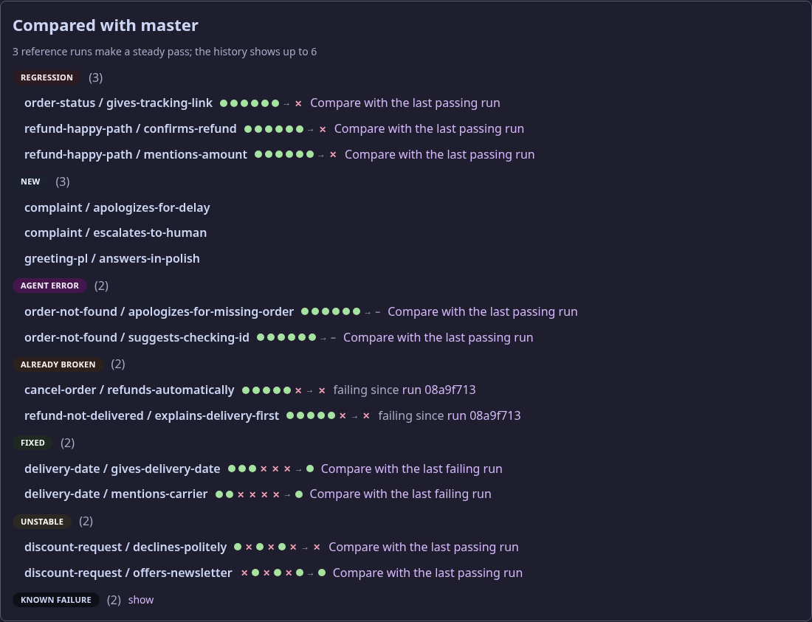
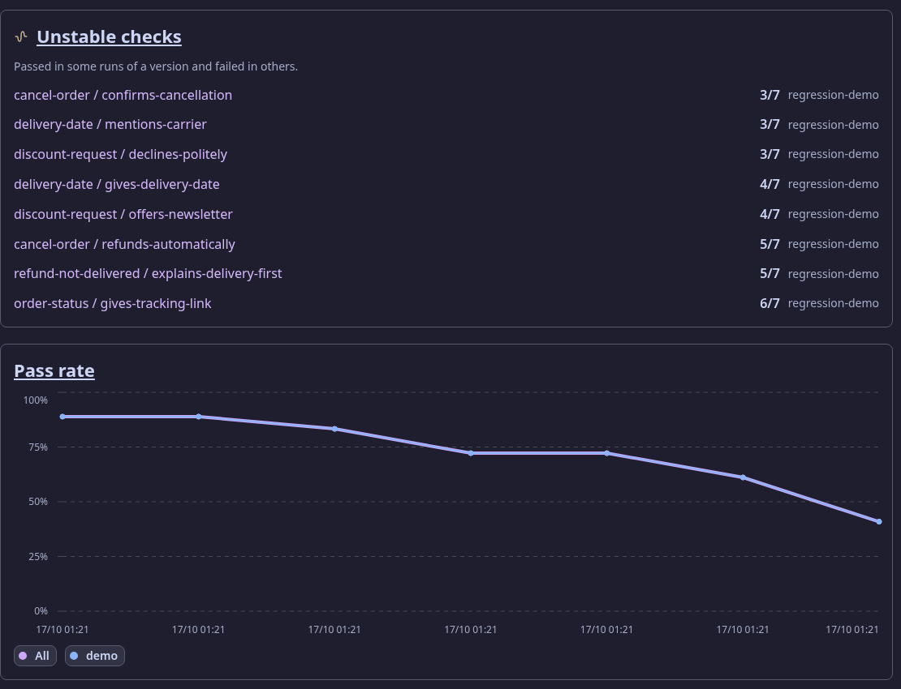
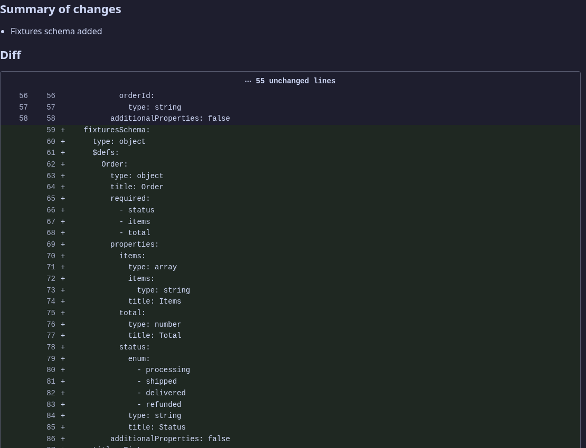

# Suwageval

Regression testing for LLM agents. Scenarios — a conversation plus checks on the agent's next answer — live as
YAML in the agent's repository. Suwageval sends them to the running agent over HTTP, several times each, checks
the answers (tool calls, events, text, an LLM judge) and tells you after a prompt or model change **what got
worse** — and what is only noise.

## What you get

**Regressions, not just failures.** Every check keeps its history on your main branch, so a failure is a
*regression*, a *new* check, an *agent error*, *already broken*, *unstable* or *known* — and CI fails only on
the first three.



**Trends per agent.** Pass rate and turn time over runs, with version changes marked, and the checks that are
unstable within one version. A run counts toward a tag's line only if it ran every scenario of that tag.



**What changed between versions.** Suwageval reads the agent's version (models, prompts, tools) from the running
agent and diffs any two.



Also: comparing up to 20 runs side by side, optionally against a baseline run, and re-checking stored answers after you fix a check.

## Claude Code plugin

Run Suwageval from [Claude Code](https://claude.com/claude-code) in plain words: the plugin sets the CLI up,
writes scenarios from a conversation, repairs the ones an agent change broke, runs them and explains what failed.

```
/plugin install suwageval --marketplace Manomenu/suwalski-agent-eval
```

Then ask, or use `/suwageval:scenario`, `/suwageval:fix`, `/suwageval:run` — see
[docs/front-doors.md](docs/front-doors.md#use-it-from-claude-code).

## Quick start

Needs the .NET 10 SDK, `just` and Docker with `docker compose`.

```sh
git clone https://github.com/Manomenu/suwalski-agent-eval && cd suwalski-agent-eval
just up                                    # Suwageval on http://localhost:8093
just cli-install                           # the `suwageval` command
```

Your agent serves two routes: `GET /suwageval/contract` (what it is) and `POST /suwageval/turn` (its answer to a
conversation) — see [docs/scenario-format.md](docs/scenario-format.md). Then, in the agent's repository:

```sh
suwageval init --suwageval-url http://localhost:8093   # suwageval/agent.yaml (asks for the name and the agent's address)
```

```yaml
# suwageval/scenarios/refund-too-late.yaml
key: refund-too-late
conversation:
  - user: "I bought a kettle 20 days ago and want my money back."
checks:
  - key: no-refund-issued
    type: tool-not-called
    tool: refund_order
```

```sh
suwageval push           # the agent and its scenarios
suwageval run --wait     # prints regressions first, exits 1 on them — ready for CI
```

## Documentation

- [docs/scenario-format.md](docs/scenario-format.md) — the files, the agent contract, every check, regressions
- [docs/concepts.md](docs/concepts.md) — scenarios, runs, checks and how regressions are decided
- [docs/front-doors.md](docs/front-doors.md) — the web app, every CLI command, the Claude Code plugin
- [docs/universal-approach.md](docs/universal-approach.md) — why the contract and the checks look the way they do
- [docs/architecture.md](docs/architecture.md), [docs/development.md](docs/development.md), [docs/roadmap.md](docs/roadmap.md)
- [AGENTS.md](AGENTS.md) — rules for changing this repository

## License

MIT, © 2026 Piotr Gugnowski — see [LICENSE](LICENSE).
