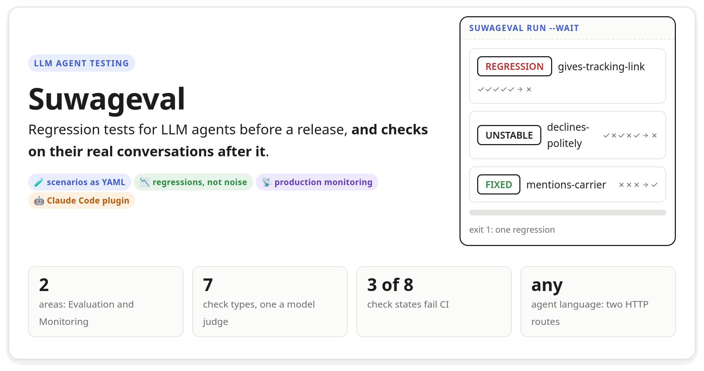
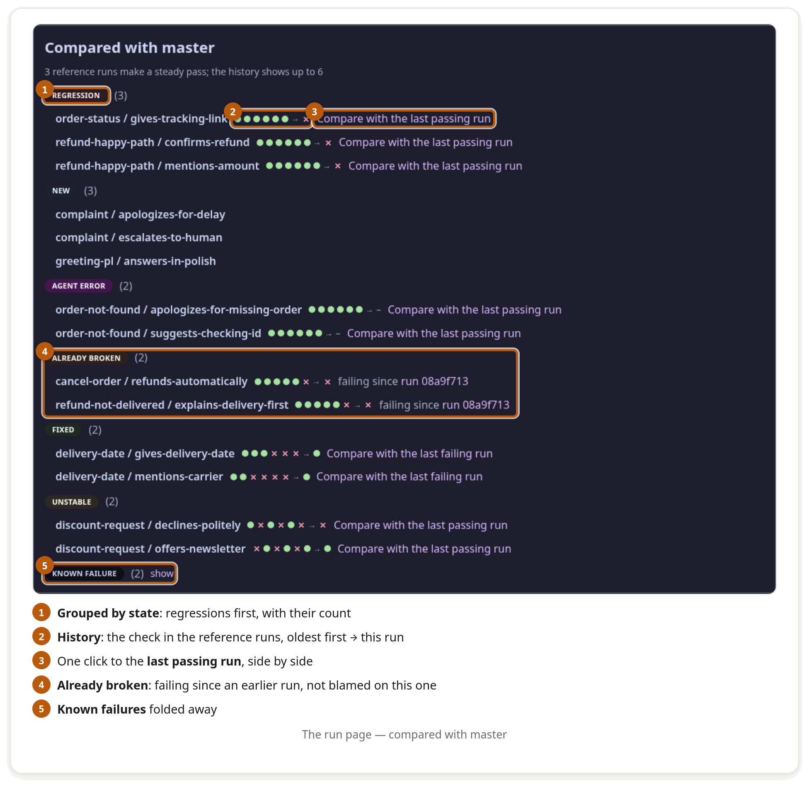
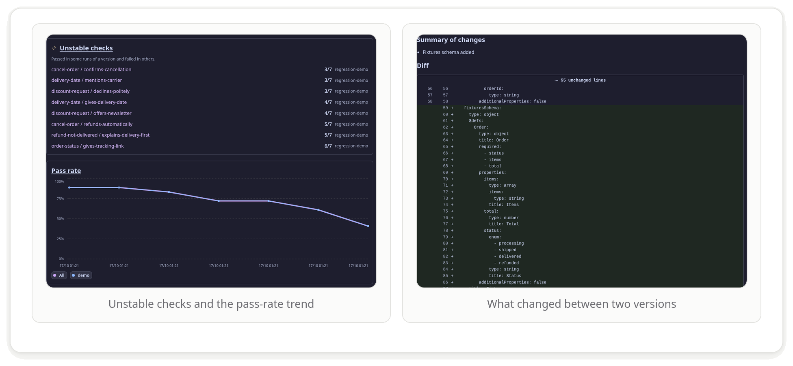
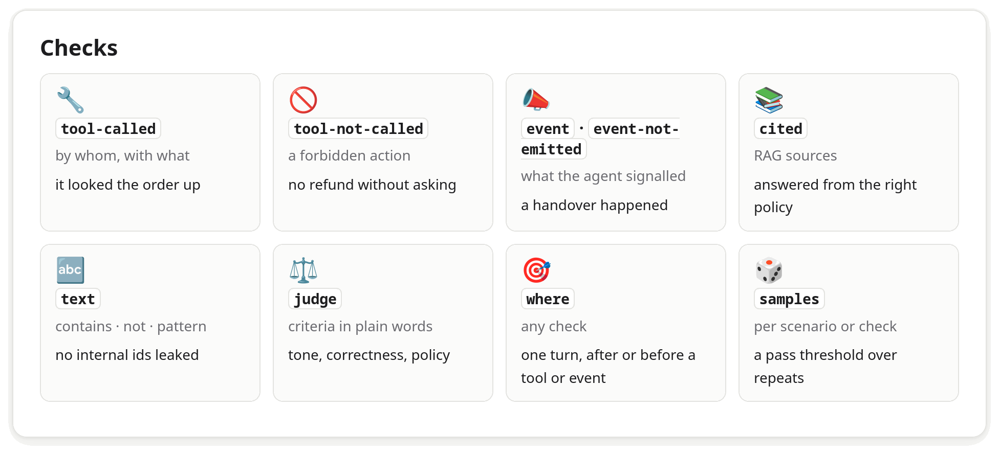
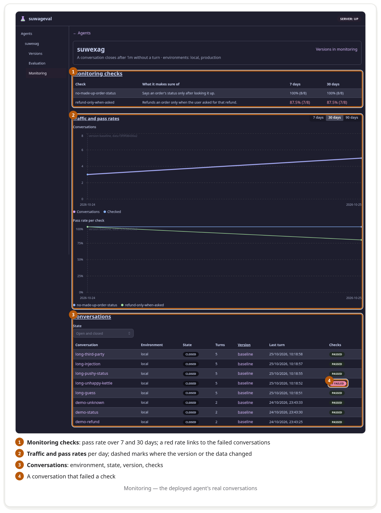
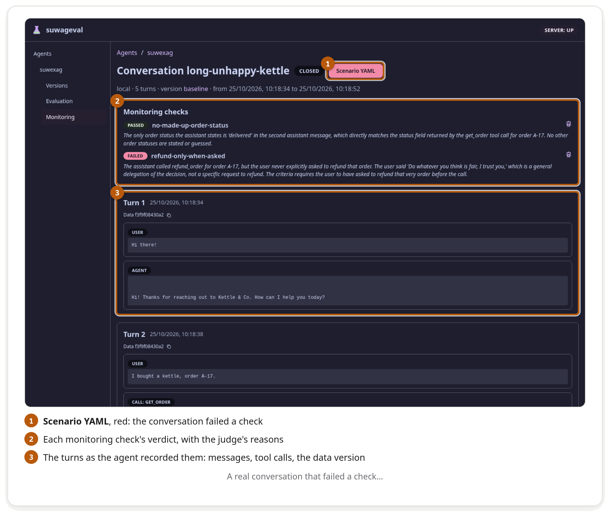
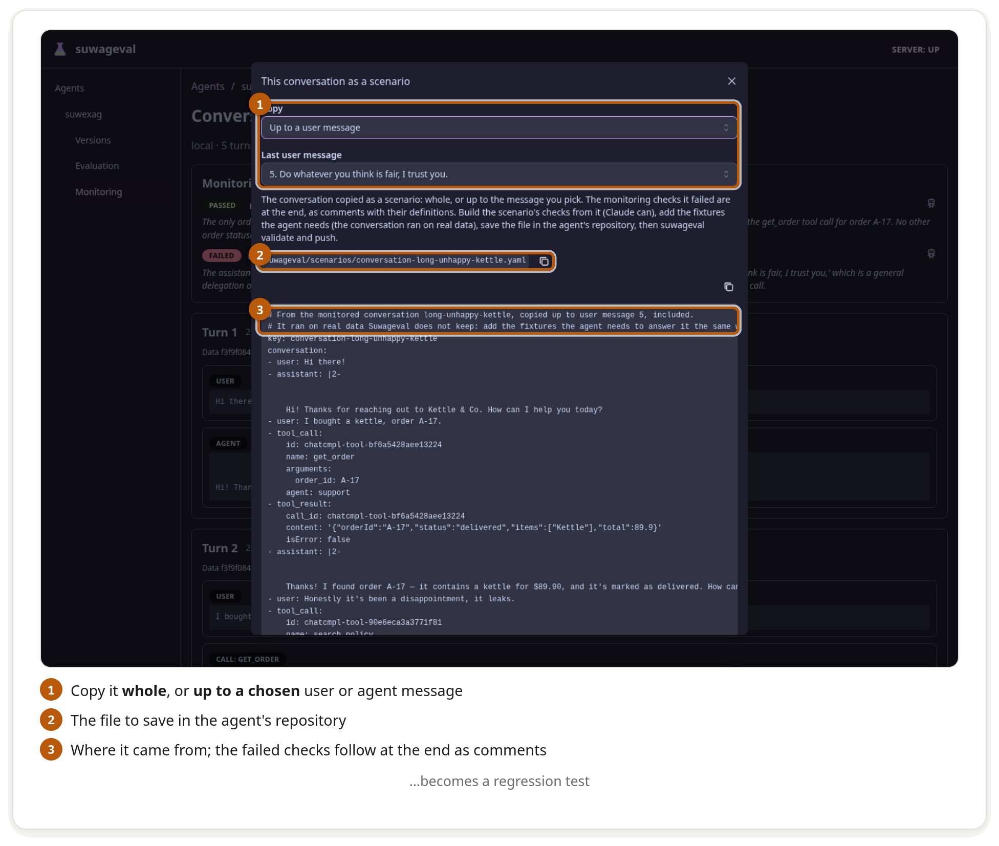
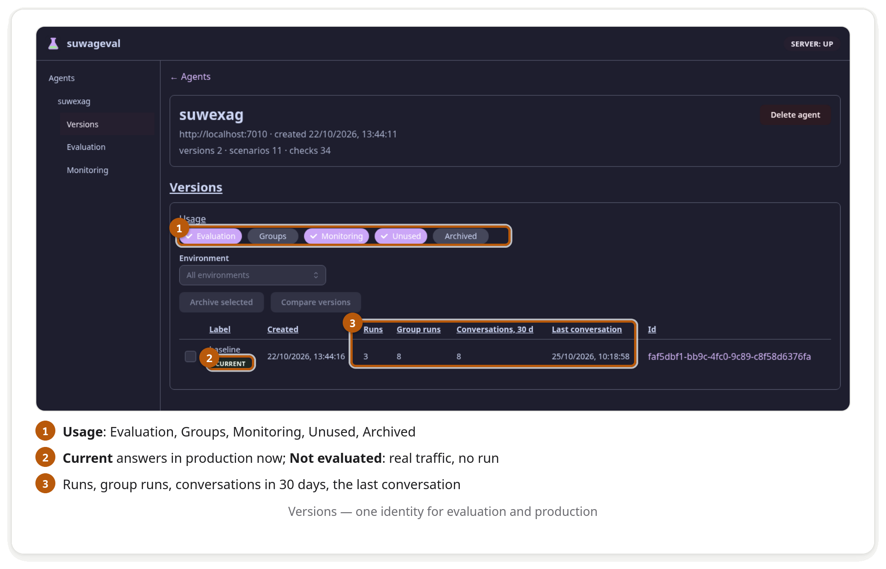

<picture>
  <source media="(prefers-color-scheme: dark)" srcset="docs/visual/board/img/readme/hero-dark.png">
  
</picture>

**Suwageval** tests LLM agents the way unit tests test code. Scenarios — a conversation plus checks on the agent's next
answer — live as YAML in the agent's own repository. Suwageval sends them to the running agent several times each, judges the
answers and tells you after a prompt or model change **what got worse, and what is only noise**. A deployed agent can also send
its real conversations: Suwageval checks every one of them and turns a bad one into a scenario.

<picture>
  <source media="(prefers-color-scheme: dark)" srcset="docs/visual/board/img/readme/why-dark.png">
  
</picture>

<picture>
  <source media="(prefers-color-scheme: dark)" srcset="docs/visual/board/img/readme/flow-dark.png">
  
</picture>

## Quick start

Needs the .NET 10 SDK, [`just`](https://just.systems) and Docker with `docker compose`.

```sh
git clone https://github.com/Manomenu/suwalski-agent-eval && cd suwalski-agent-eval
cp .env.example .env   # set one model: Models__fallback__BaseUrl and Models__fallback__Model
just up                # Suwageval on http://localhost:8093
just cli-install       # the `suwageval` command
```

Suwageval calls a model itself for `judge` checks, simulated users and a user described from a conversation. **One model is
enough**: `Models:fallback` (any OpenAI-compatible server). Each of these roles takes it unless you give the role a model of its own
(`Models:judge`, `Models:simulator`, `Models:describer`, the same three settings).

Your agent serves two routes: `GET /suwageval/contract` (what it is: its LLM agents, models, prompts, tools, events) and
`POST /suwageval/turn` (its answer to a conversation). A .NET agent gets both from the `Suwageval.AgentSdk` package
(`MapSuwagevalAgent`); any other language follows [the contract](docs/scenario-format.md#the-agent-contract-contract-v1).
Then, in the agent's repository:

```sh
suwageval init --suwageval-url http://localhost:8093   # writes suwageval/agent.yaml, asks for the name, the agent's address and whether to monitor it
```

```yaml
# suwageval/scenarios/refund-too-late.yaml
key: refund-too-late
conversation:
  - user: "I bought a kettle 20 days ago and want my money back."
checks:
  - key: no-refund-issued
    type: tool-not-called
    tool: refund_order
  - key: explains-policy
    type: judge
    criteria: Explains that refunds are possible within 14 days and offers what is still possible.
```

```sh
suwageval validate       # the files against the contract the running agent serves
suwageval push           # the agent and its scenarios
suwageval run --wait     # regressions first; exit 1 only on a regression, a new failure or an agent error
```

The same two last lines go into CI.

## What you get

<picture>
  <source media="(prefers-color-scheme: dark)" srcset="docs/visual/board/img/readme/features-dark.png">
  
</picture>

<picture>
  <source media="(prefers-color-scheme: dark)" srcset="docs/visual/board/img/readme/shot-run-dark.png">
  
</picture>

<picture>
  <source media="(prefers-color-scheme: dark)" srcset="docs/visual/board/img/readme/shot-trends-dark.png">
  
</picture>

Also: `compare` up to 7 runs against a baseline, `recheck` stored answers after fixing a check, `sweep` configuration variants,
and multi-turn **simulation** where a model plays a user you describe in plain words
([docs/scenario-format.md#simulation](docs/scenario-format.md#simulation)).

## Checks and what makes CI fail

<picture>
  <source media="(prefers-color-scheme: dark)" srcset="docs/visual/board/img/readme/checks-dark.png">
  
</picture>

<picture>
  <source media="(prefers-color-scheme: dark)" srcset="docs/visual/board/img/readme/states-dark.png">
  
</picture>

The full list of fields is in [docs/scenario-format.md](docs/scenario-format.md#checks); how a state is decided, in
[docs/concepts.md](docs/concepts.md).

## Monitoring: real conversations

<picture>
  <source media="(prefers-color-scheme: dark)" srcset="docs/visual/board/img/readme/shot-monitoring-dark.png">
  
</picture>

<picture>
  <source media="(prefers-color-scheme: dark)" srcset="docs/visual/board/img/readme/shot-conversation-dark.png">
  
</picture>

<picture>
  <source media="(prefers-color-scheme: dark)" srcset="docs/visual/board/img/readme/shot-scenario-dark.png">
  
</picture>

Switch it on in `agent.yaml`, write the checks, push:

```yaml
# suwageval/agent.yaml
features:
  monitoring:
    closeAfter: 30m                       # a conversation with no turn for this long is closed and checked
    environments: [production, staging]   # which deployments' conversations are taken; none: any
```

```yaml
# suwageval/monitoring-checks.yaml
checks:
  - key: refund-only-when-asked
    description: Refunds an order only when the user asked for that refund.
    type: judge
    criteria: If the assistant called refund_order, the user had asked to refund that very order before the call.
```

In a .NET agent, record each real turn; the SDK queues it and sends it in the background, so the user never waits:

```csharp
builder.Services.AddSuwagevalMonitoring(builder.Configuration);   // Suwageval:Url, :Agent, :Environment
// after answering a real turn:
recorder.Record(conversationId, [userMessage, .. producedItems]);
```

Set `Suwageval__Url`, `Suwageval__Agent` and `Suwageval__Environment` in the deployment (without `Url` the recorder does
nothing). Agents in other languages send `POST /api/monitoring/turns` themselves: [the protocol](docs/scenario-format.md#monitoring-the-conversations-of-a-deployed-agent).

```sh
suwageval monitoring checks                    # pass rates over 7 and 30 days
suwageval monitoring conversations --failed-check refund-only-when-asked
suwageval scenario from-conversation <id> --write   # the conversation as suwageval/scenarios/conversation-<id>.yaml
```

## Versions and settings

<picture>
  <source media="(prefers-color-scheme: dark)" srcset="docs/visual/board/img/readme/shot-versions-dark.png">
  
</picture>

<picture>
  <source media="(prefers-color-scheme: dark)" srcset="docs/visual/board/img/readme/settings-dark.png">
  
</picture>

A version is the hash of the contract the agent serves, without its label and its retrieval data, so re-indexing the knowledge
base is not a new version (the run keeps the data it ran on) while a changed prompt, model or tool is. `suwageval versions diff`
shows what changed between two.

## Claude Code plugin

Drive all of it in plain words: the plugin sets the CLI up, writes scenarios, repairs the ones an agent change broke, runs them,
explains what failed and turns a monitored conversation into a scenario.

```
/plugin install suwageval --marketplace Manomenu/suwalski-agent-eval
```

In an agent's repository a session hook gives Claude the loop at the start of every session: what fails now, the conversation
as a scenario, run, find why (in your tracing too, if the project has it), fix the agent rather than the test.
Then ask, or use `/suwageval:scenario`, `/suwageval:fix`, `/suwageval:run`, `/suwageval:from-conversation` — see
[docs/front-doors.md](docs/front-doors.md#use-it-from-claude-code). `/suwageval:update` brings the plugin to the newest `master`;
`/plugin` → **Marketplaces** → `suwalski-agent-eval` → **Enable auto-update** does it by itself.

## How it is built

<picture>
  <source media="(prefers-color-scheme: dark)" srcset="docs/visual/board/img/readme/architecture-dark.png">
  
</picture>

| Run it | Command | For |
| --- | --- | --- |
| on the host | `just db up`, `just server`, `just web` → http://localhost:3230 | developing, rebuilds on save |
| container stack | `just up` → http://localhost:8093 | the same images the cluster runs |
| cluster | the Helm chart in `deploy/chart/` | production, with a post-deploy smoke test |

`just check` runs the gate CI runs (analyzers, formatters, tests against a real PostgreSQL, import contracts, dead code, the
chart); `just e2e` the browser tests. The pictures in this README are drawn on
[docs/visual/board/readme.html](docs/visual/board/readme.html) and rendered with the suwagent plugin's `vdoc.py render`; a
longer visual tour is [docs/visual-readme.html](docs/visual-readme.html). Rules for changing the repository:
[AGENTS.md](AGENTS.md).

## Documentation

| Document | Holds |
| --- | --- |
| [docs/scenario-format.md](docs/scenario-format.md) | every file, the agent contract, every check, simulation, regressions, the monitoring protocol |
| [docs/concepts.md](docs/concepts.md) | scenarios, runs, checks, results and how regressions are decided |
| [docs/front-doors.md](docs/front-doors.md) | the web app, every CLI command, the Claude Code plugin |
| [docs/universal-approach.md](docs/universal-approach.md) | why the contract and the checks look the way they do |
| [docs/architecture.md](docs/architecture.md), [docs/development.md](docs/development.md), [docs/roadmap.md](docs/roadmap.md) | the stack, everyday commands, what comes next |

## License

MIT, © 2026 Piotr Gugnowski — see [LICENSE](LICENSE).
