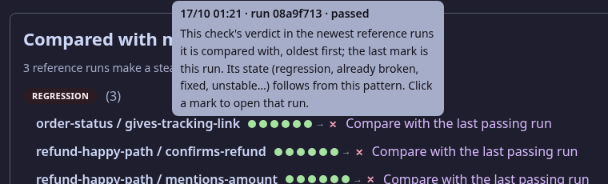
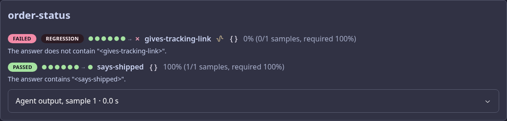
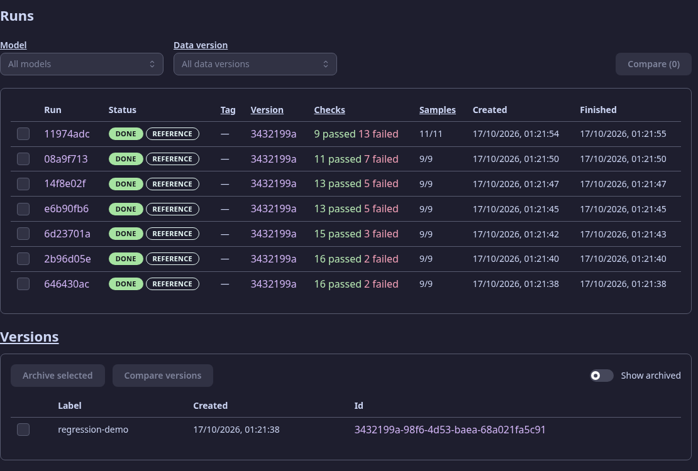
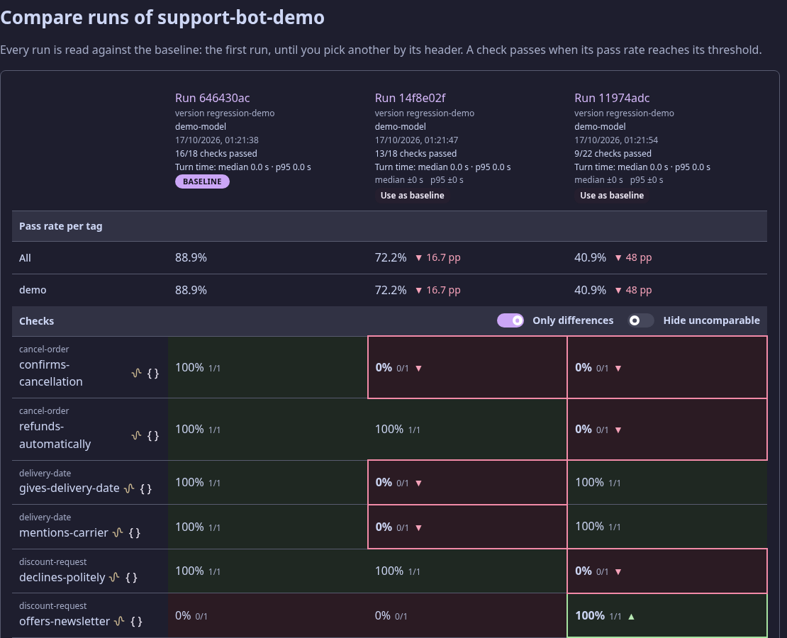

# Suwageval

Suwageval is regression testing for LLM agents. You keep scenarios — a frozen conversation plus
checks on the agent's next turn — as YAML files in the agent's repository. Suwageval replays them
against the running agent over HTTP, several samples each, and checks the answers: tool calls,
events, text patterns, and an LLM judge for what a pattern cannot say. A web app shows the results,
a CLI runs them in CI with an exit code, and a Claude Code plugin writes and runs scenarios for you.

It exists to answer one question after you change a prompt or a model: **what got worse?** Every
check keeps its history, so a check that passed in the last runs and fails now is a regression, and
a check that flips between passes and failures is reported as noise, not as a regression.

## What you get

### Regressions told apart from noise

Each failed check is put in one state, computed from its history on your main branch:
**Regression** (passed steadily, fails now), **New**, **Agent error** (the agent gave no answer),
**Already broken**, **Known failure**, **Fixed** and **Unstable**. The run page lists them grouped,
with the history of every check as a strip of marks (oldest first, this run last).


Hover a mark to see which run it is; click it to open that run.



Every check in the run keeps its verdict, its reason and its history next to it:



Exit code 1 only for regressions, new failing checks and agent errors — a check that was already
broken or is known to be flaky does not fail your pipeline (`--strict` fails on any failed check).
The rules are in [docs/concepts.md](docs/concepts.md) and [docs/scenario-format.md](docs/scenario-format.md).

### The agent page

Runs with their totals, pass-rate and turn-time trends (median and p95) per scenario tag, the checks
that are unstable across runs of one version, the agent's versions, and its configuration.
A model does not answer the same way twice; the "Unstable checks" card shows which checks to give
more `samples`.




### Comparing runs

Tick 2 to 5 runs and compare them against a baseline: pass rate per tag, and per check where the
runs differ (`suwageval compare <runId> <runId> …` opens the same page).



### Versions: what changed

The version of an agent is not a file: Suwageval reads it from the running agent
(`GET /suwageval/contract`: every LLM agent with its model, prompt and tools, and the retrieval
data version). Change a prompt, a model or a tool and the next run is on a new version; the diff
shows exactly what changed (`suwageval versions diff <a> <b>`).


### Re-check

Fixed a check — a pattern, a judge's criteria? "Re-check" (`suwageval recheck <runId>`) judges the
stored answers of a finished run again with the current checks, without calling the agent, so any
difference comes from the checks alone.

### In CI

`suwageval run --wait` prints the comparison and exits non-zero on regressions. Real output on a demo agent
(`✓✓✓✗ → ✗` is the check's history, oldest first, then this run):

```
version 3432199a-98f6-4d53-baea-68a021fa5c91: existing
compared with master (3 reference runs make a steady pass; history up to 6)

✗ 3 regressions
  order-status / gives-tracking-link   ✓✓✓✓✓✓ → ✗  The answer does not contain "<gives-tracking-link>".
  refund-happy-path / confirms-refund  ✓✓✓✓✓✓ → ✗  The answer does not contain "<confirms-refund>".
  refund-happy-path / mentions-amount  ✓✓✓✓✓✓ → ✗  The answer does not contain "<mentions-amount>".
✗ 3 new checks failing
  complaint / apologizes-for-delay  The answer does not contain "<apologizes-for-delay>".
  complaint / escalates-to-human    The answer does not contain "<escalates-to-human>".
  greeting-pl / answers-in-polish   The answer does not contain "<answers-in-polish>".
✗ 2 agent errors
  order-not-found / apologizes-for-missing-order  ✓✓✓✓✓✓ → –  The agent answered 500 Internal Server Error: {"error": "demo failure"}
  order-not-found / suggests-checking-id          ✓✓✓✓✓✓ → –  The agent answered 500 Internal Server Error: {"error": "demo failure"}
! 2 already broken                  not caused by this run
  cancel-order / refunds-automatically            ✓✓✓✓✓✗ → ✗  failing since run 08a9f713
  refund-not-delivered / explains-delivery-first  ✓✓✓✓✓✗ → ✗  failing since run 08a9f713
✓ 2 fixed
  delivery-date / gives-delivery-date  ✓✓✓✗✗✗ → ✓
  delivery-date / mentions-carrier     ✓✓✗✗✗✗ → ✓
~ 2 unstable
  discount-request / declines-politely  ✓✗✓✗✓✗ → ✗
  discount-request / offers-newsletter  ✗✓✗✓✗✓ → ✓
  2 known failures

22 checks: 9 passed, 13 failed
http://localhost:3230/runs/11974adc-a6c4-4712-8ec6-b933c37627e0
```

Exit code: 0 when nothing regressed, 1 on a regression, a new failing check or an agent error,
2 when the run could not finish. `--json` prints the same for machines.

## Quick start

You need the .NET 10 SDK, `just` and Docker (or podman behind the `docker` command) with
`docker compose`.

**1. Start Suwageval** — the server, its database and the web app, in containers:

```sh
git clone https://github.com/Manomenu/suwalski-agent-eval
cd suwalski-agent-eval
just up            # web app (and the API under /api) on http://localhost:8093
```

`just down` stops it; the data stays in a volume. (To work on Suwageval itself, see
[docs/development.md](docs/development.md).)

**2. Install the CLI** and point it at the server:

```sh
just cli-install                          # installs the `suwageval` .NET tool
export SUWAGEVAL_URL=http://localhost:8093   # the web app's address; the default is :3230
```

**3. Implement the agent contract** — two routes on your agent, nothing else:

- `GET /suwageval/contract` says what the agent is, so every run records what really ran:

  ```json
  { "label": "3f2a9c1",
    "agents": [{ "name": "support-agent", "model": { "name": "gpt-4o-mini" },
                 "config": "You are a polite customer support agent ...", "tools": [] }] }
  ```

- `POST /suwageval/turn` gets `{ "conversation": [...] }` and answers `{ "items": [...] }` with what
  the agent produced for the last message, e.g.
  `{ "items": [{ "kind": "AssistantMessage", "text": "Refunds are possible within 14 days." }] }`.
  Tool calls and events are items too. Tools are not executed for real: the scenario supplies what
  they returned.

Every field, tool calls, events, retrieval, fixtures: [docs/scenario-format.md](docs/scenario-format.md).

**4. Describe the agent and a scenario** in the agent's repository, in `suwageval/`:

```yaml
# suwageval/agent.yaml
name: my-agent
endpointUrl: http://localhost:8000
```

```yaml
# suwageval/scenarios/refund-too-late.yaml
key: refund-too-late
tags: [regression]
samples: 3                  # ask 3 times: a model is not deterministic
conversation:
  - user: "I bought a kettle 20 days ago and want my money back."
checks:
  - key: no-refund-issued
    type: tool-not-called
    tool: refund_order
  - key: states-refund-window
    type: text
    pattern: "14[- ]day"
    passThreshold: 0.8      # 80% of the samples must pass
```

Check types: `tool-called`, `tool-not-called`, `event`, `event-not-emitted`, `cited`, `text`, and
`judge` (a model grades the answer against criteria in plain words; it needs a judge model set up
in `.env`, see `.env.example`).

**5. Validate, push, run:**

```sh
suwageval validate                    # the files, and tool names against the running agent
suwageval push                        # the agent and its scenarios go to the server
suwageval run --tag regression --wait # run, print the comparison, exit 0/1/2
```

The last line of the output is the link to the run's page. The first runs on the main branch build
the history; regressions are reported once a check has enough of it (5 runs by default, the
`regression.history` setting).

## Front doors

| Who | Through | Does |
| --- | --- | --- |
| a person | the web app | agents, scenarios, runs, results, comparisons, version diffs |
| an agent's repository or CI | the `suwageval` CLI | `validate`, `push`, `run`, `rerun`, `recheck`, `cancel`, `results`, `runs`, `compare`, `unstable`, `agent-errors`, `versions` |
| Claude Code | the plugin in `claude-plugin/` | writes scenarios from a conversation, fixes them, runs them and explains failures |

Everything the web can do, the CLI can do too. Details of every command and the plugin's
commands: [docs/front-doors.md](docs/front-doors.md).

### Claude Code plugin

```
/plugin install suwageval --marketplace Manomenu/suwalski-agent-eval
```

Then ask in plain words, or use `/suwageval:scenario the agent refuses a refund after 14 days`,
`/suwageval:fix`, `/suwageval:run tag regression`, `/suwageval:versions`. The plugin drives the
CLI, so install the CLI first (step 2).

## Documentation

- [docs/scenario-format.md](docs/scenario-format.md) — the files in `suwageval/`, the agent contract, every check, regressions
- [docs/concepts.md](docs/concepts.md) — scenarios, runs, checks, results and regressions
- [docs/front-doors.md](docs/front-doors.md) — the web app, every CLI command and the Claude Code plugin
- [docs/universal-approach.md](docs/universal-approach.md) — why the contract and the checks look the way they do
- [docs/architecture.md](docs/architecture.md) — the stack and how the parts fit together
- [docs/development.md](docs/development.md) — building, running and testing Suwageval itself
- [docs/roadmap.md](docs/roadmap.md) — status, open questions, what is done and what is next
- [AGENTS.md](AGENTS.md) — the rules for changing this repository

## License

MIT, © 2026 Piotr Gugnowski — see [LICENSE](LICENSE).
